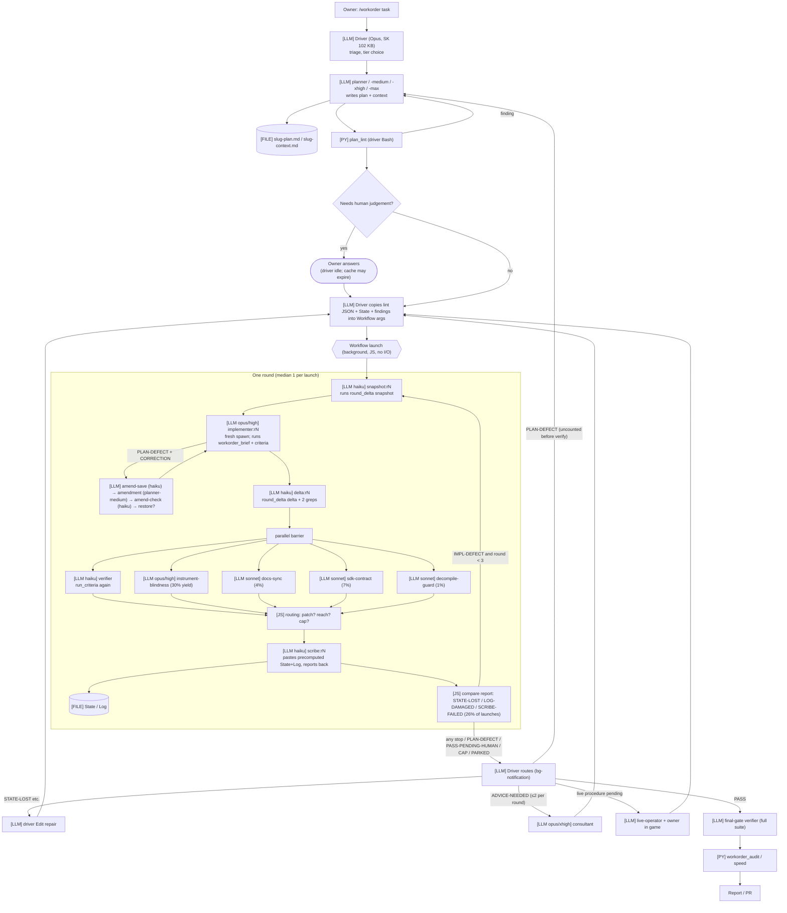
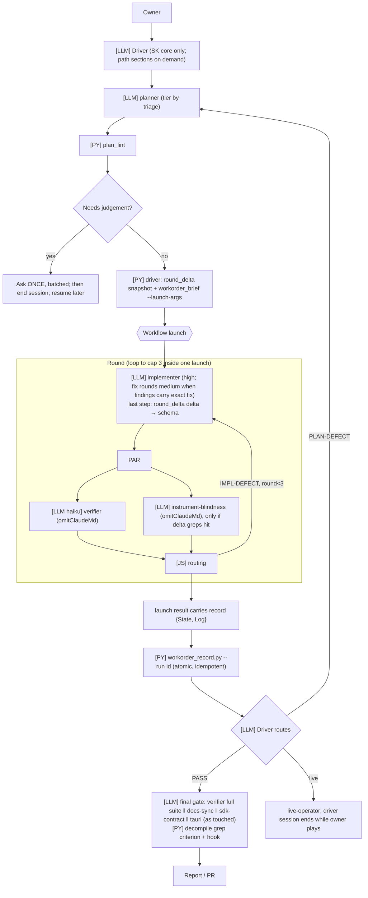

# `/workorder` Architecture Audit

Repository: hero-siege-offline-toolkit, audited at `c4529da` (worktree `audit-workorder-architecture`), 2026-10-11.
Spec: `audit.md` (the owner's brief). The audit itself was read-only: no model call was made to gather evidence. Every path:line below refers to the tree **at `c4529da`, before the fixes**. Line numbers in `workorder-rounds.js` and `SKILL.md` have moved since.

Companion files:
- `ledger.md`: the findings ledger.
- `discovery-execution-path.md`: the call graph, with path:line evidence.
- `discovery-context-inventory.md`: the fixed-context inventory.
- `data/*.md`: the measurements. The raw per-request CSVs are gitignored.
- `scripts/*.py`: the local scripts that produced them. They read `~/.claude/projects/*hero-siege-offline-toolkit*` and make no model calls. Run `usage.py` first; then `analyze.py`, `timing.py`, `wfruns.py`, `wfresults.py`, `reads.py`, `cost.py` and `cachew.py` each write one `data/*.md`. `otel_summary.py` summarises the telemetry week (Appendix C).

## Implementation status (hub #485)

| Finding | What changed | Where |
|---|---|---|
| F01 scribe bookkeeping | The launch returns `record {rounds:[{stateLines, logBlock}]}`. The driver applies it with `tools/workorder_record.py apply --run <runId>` (idempotent per run and round). STATE-LOST, LOG-DAMAGED and SCRIBE-FAILED are removed. The scribe agent is retired, but its file is kept for a follow-up removal | `workorder-rounds.js`, `SKILL.md`, `tools/workorder_record.py` |
| F02 snapshot/delta agents | The implementer runs snapshot first and delta, the greps and `decompile_check` last, and reports them in its schema. Lanes keep one snapshot agent, because they would race on the file | `workorder-rounds.js`, `implementer.md` |
| F03 reviewer yield | Only instrument-blindness runs every round. sdk-contract, docs-sync and tauri run at the `finalGate: true` launch, which has no implementer. decompile-output-guard is replaced per round by `tools/decompile_check.py`, which reuses the hook's detection; the LLM guard runs at the final gate only when docs or `*.md` change | `workorder-rounds.js`, `tools/decompile_check.py` |
| F04/F16 driver | The driver ends the session at owner and live gates and resumes from the files. `workorder_brief.py --launch-args`. SKILL.md went from 101.7 KB to 65.9 KB, with path sections split into `items.md`, `amendments.md`, `live-gate.md`, `checks-and-overlap.md`, `model-tiers.md` and `verify-mechanics.md` | `.claude/skills/workorder/` |
| F05/F11/F14 spawn context | `omitClaudeMd: true` on the verifier, the five reviewers and the scribe. The rules each one applies are restated in its body. Planner and implementer duplicates of AGENTS.md became pointers, which also fixes the Ghidra drift. Variant descriptions are shortened | `.claude/agents/`, `tools/sync_agent_tooling.py` |
| F08 one round per launch | IMPL-DEFECT and BLOCKING rounds continue inside the launch up to the caps | `workorder-rounds.js` |
| F10 duplicate criteria | `run_criteria.py --reuse <dir>`: a result is reused only on matching HEADs and `(reads)` hash, never for `(final)`, whole-suite or unread criteria, and never at the final gate. Approved by the owner on 2026-10-11 | `tools/run_criteria.py`, `verifier.md`, `workorder-rounds.js` |
| F13 uncapped loops | A `launches:` State line, with a stop for the owner after 6. Every PLAN-DEFECT counts toward `replans:` | `workorder-rounds.js`, `SKILL.md` |
| F06/F09 implementer and planner cost | Not changed: measure first (§23) | — |
| Telemetry (Appendix C) | One week of local OTel, set up outside the repo in user settings | `scripts/otel_summary.py` |

Abbreviations: **WF** = `.claude/workflows/workorder-rounds.js`, **SK** = `.claude/skills/workorder/SKILL.md`, **CAL** = `docs/agents/workorder-calibration.md`.
Labels: **M** measured · **SV** statically verified · **E** estimated · **H** hypothesis · **IE** insufficient evidence.

---

## 1. Executive summary

**Architecture.** The system is a hybrid planner → implement → verify pipeline with two orchestrators:

1. **The driver.** The main Claude session follows a 102 KB skill prompt (SK) through triage, planning, replans, consultations, owner questions, the live-game relay and the report.
2. **The round engine.** A dynamic-workflow script (WF, 1,979 lines) runs each implement → verify → review → record round.

The plan and State live in two gitignored markdown files per workorder (`<slug>-plan.md`, `<slug>-context.md`). That much is good. But:
- the workflow runtime cannot touch files or run a shell (docs: "No direct filesystem or shell access from the workflow itself"; WF:868-870);
- so **every deterministic step in a round is an LLM agent**, including writing State and Log back to those files;
- and **everything between launches (owner gates, replans, relaunches, State repair) runs through the driver's ever-growing context** (SV).

**Measured baseline.** The sample is the 106 sessions that ran workorder phases, 2026-09-18 → 2026-10-10.

| Measure | Median | Mean | p90 | Max |
|---|---:|---:|---:|---:|
| Wall-clock per session | 3.9 h | 7.7 h | — | 62 h |
| Billed tokens per session | 99 M | 141 M | — | 1.4 B |
| List-price cost per session | $46 | $63 | — | $602 |
| Agent spawns per session | 35 | 51 | 121 | 336 |

- Total list price is **$6,473** (M; computed with the repo's own `MODEL_PRICES`). A subscription is not billed per token, so this is a way to compare roles, not an invoice.
- Workorder sessions account for **94% of all tokens** this project used.
- Cost split: cache reads 46%, **cache writes 37%**, output 17%.

| Question | Answer |
|---|---|
| Biggest token sink | **Implementer: 31% of cost** (939 fresh Opus/high spawns, one per round or fix). Then the **driver at 22%** (median 92 turns, median peak context 294k, max 966k) and the **planner at 20%** (334 spawns). (M) |
| Biggest latency source | **Waiting on the owner**: 46.7% of driver wall-clock (typed replies 35.7% plus `AskUserQuestion` 11.0%). Then waiting on background launches, 25.5%. Model time is only 12.4% (M). Inside a launch, rounds run strictly serially (snapshot → implementer → delta → verifier‖reviewers → scribe) at a median concurrency of **1.22** (M). |
| Biggest scalability constraint | The driver is a serial bottleneck holding all cross-launch state in context. Launches average **one round each** (median 1; M), so every round needs at least one driver turn and a relaunch. |
| Most damaging repeat behaviour | The LLM bookkeeping step fails often: **92 of 353 launches (26%) ended STATE-LOST, LOG-DAMAGED or SCRIBE-FAILED** (M). Each one forces a driver repair, then a relaunch, then a fresh round of spawns. Neither loop is a runaway: rounds cap at 3 (+3 owner-scope), replans at 2, items launches at 120 agents (SV). But relaunches after PARKED/CEILING and pre-verify PLAN-DEFECTs are uncapped (SV). |
| Highest-impact architectural mistake | **Deterministic bookkeeping is routed through LLM agents** because the round loop lives in a runtime with no I/O. That costs ~1,130 extra spawns (scribe, snapshot, delta and amend agents), serial minutes on every round, and the 26% failure rate above. |
| Overall avoidable waste (E) | **~15% of list cost expected, 7-25% range**, with the evidence in hand. Agent spawns per workorder fall ~40%. The STATE-LOST relaunch class disappears. Wall-clock gains are smaller, because owner wait dominates. |

**Top five changes**

1. **Make bookkeeping deterministic** (F01, F02). Snapshot before the launch and record after it, both as Python run by the driver: the workflow returns the precomputed State/Log in its result, and a tool applies it from the run record. Delta runs inside the implementer's last step. This removes the scribe, snapshot and delta agents and the STATE-LOST class.
2. **Base reviewer frequency on measured yield** (F03). Keep `instrument-blindness-reviewer` every round (30% yield). Run `sdk-contract`, `docs-sync` and `tauri` once at the final gate. Replace `decompile-output-guard` (1% yield, 3 blocking findings in 240 rounds) with the existing deterministic hook plus a grep criterion.
3. **Cut spawn context** (F05, F11). Set `omitClaudeMd: true` on the verifier, reviewers, scribe and utility agents, moving the few rules they need into their bodies. Remove the AGENTS.md paragraphs restated in agent bodies. Configuration only.
4. **Stop holding the driver across idle gaps** (F04, F16). End the session at owner and live gates and resume from the files: `resume` already exists and re-warms ~60k, not 300k+. Have a tool assemble the launch args instead of the driver copying State and lint JSON.
5. **Rounds per launch and owner-question batching** (F07, F08). Let one launch carry the round loop through fix rounds and to the final gate (cap 3 is already there). Before asking the owner anything, start the work the answer cannot change, which the rule in AGENTS.md already requires.

**Evidence quality.** High for tokens, spawns, durations and outcomes: 116,617 deduplicated requests across 5,656 contexts and 353 saved workflow-run records. Medium for how much each change will save, because there is no controlled before/after run. The main unknowns:
- the quality cost of reducing reviewer frequency, and of implementer effort changes;
- the true system-prompt and tool-schema size per agent (not on disk);
- `/usage` and `/context` readings, which only you can take.

---

## 2. Audit coverage and evidence quality

| Item | Value |
|---|---|
| Claude Code version | 2.1.296 (M: `claude --version`) |
| Auth / billing | claude.ai subscription, Team (clauth profiles). Main-context cache writes are 100% 1-hour TTL (56.0M of 56.0M); subagent and workflow writes are 0% 1-hour, i.e. the default 5-minute TTL (M: `data/aggregates.md`) |
| Models observed | `claude-opus-5-5` (driver, implementer, planner, instrument-blindness), `claude-sonnet-5`/`5-5` (most reviewers, early live-operator), `claude-haiku-4-5` (verifier, scribe, utility agents), plus `claude-haiku-5-5`, `claude-fable-5-1`, `claude-opus-5`, and some `deepseek-*` through clauth profiles (3,626 requests unpriced) |
| Settings scopes inspected | repo `.claude/settings{,.local}.json`, `.mcp.json`, user `~/.claude/settings{,.local}.json`, plugins, memory. No managed settings and no user CLAUDE.md, agents or workflows (`discovery-context-inventory.md`) |
| Enabled plugins with hooks | impeccable (PostToolUse Edit\|Write 5 s, Stop 30 s); clauth (SessionStart, UserPromptSubmit, PostToolUse on every tool, 10 s) |
| Transcript sample | `~/.claude/projects/*hero-siege-offline-toolkit*`: 6,048 jsonl files, 199 sessions, 5,656 contexts with usage, **116,617 requests** deduplicated by `message.id` (keeping the entry with the largest `output_tokens`), window 2026-09-18 → 2026-10-10. A workorder session is one that spawned a planner, implementer, verifier, scribe or live-operator: 106 sessions, 95% of requests |
| Workflow run records | 353 `workflows/wf_*.json` (outcome, rounds, verifier verdict, blocking findings per reviewer) |
| Traced | entry (SK) → triage → planner → plan_lint → Workflow args → WF round loop and items loop → routing → scribe → driver routing → live gate → final gate → audit tools |
| Not traced / limits | System-prompt and built-in tool-schema size per agent: not on disk (**IE**). Hooks' actual per-call latency: only 22 recorded durations. Quality impact of each change: no controlled run (**IE**). Codex path (`.codex/`): out of scope. `/usage` and `/context` not run, because they need the owner |
| Owner-supplied measurements (2026-10-11) | `/usage` and `/context` from the issue-484 (x64dbg MCP) session. **`/usage`:** $123.79; API 4h33m vs wall 11h20m (**API = 40% of wall**); Opus 5.5 $123.41 of it; main prompt cache: 142 requests, 98% from cache, 2 misses (412k re-cached), "cold — idle 1h57m, next turn re-caches ~383.6k". Usage attribution: implementer 29%, planner-max 13%, instrument-blindness 6%, live-operator 5%. **`/context`** (driver, 383.6k): system prompt 3.6k, system tools 12.5k, MCP tools 1.5k (deferred, 407 tools), MCP instructions 2.2k, custom agents 2.2k, **memory files (CLAUDE.md + AGENTS.md + MEMORY.md) 25.2k**, skills 10k, messages 326.4k (M) |
| Docs verified against | code.claude.com/docs/en/workflows (no fs/shell in scripts; 5-min agent TTL; `subagentPromptCacheTtl`; prefix sharing only for same model, effort, type, tools, schema and cwd; schema retries 5; stall restarts ≤5), /sub-agents (`omitClaudeMd` ≥ v2.1.271; settings hooks fire in subagents; auto memory not loaded in subagents; fresh spawn vs resume) |

How this report is built: every token or cost figure is from transcripts (M). Byte sizes are from files (SV), and token equivalents of file sizes are bytes/4 ±20% (E).

---

## 3. Architecture map

| Component | Location | Role | Runs as |
|---|---|---|---|
| `/workorder` skill | SK (102 KB ≈ 25k tok E) | driver procedure: triage tables, tier tables, routing, live gate, report | main session LLM (Opus 5.5; effort recommended medium, "not measured", SK:1464-1472) |
| Round engine | WF | round loop and items event loop; deterministic routing; JS memory State (`knownState`) | Workflow runtime (JS, no I/O) |
| planner (+medium/xhigh/max) | `.claude/agents/planner*.md` (42.7 KB body ×4 identical copies) | writes plan/context, mechanical criteria | Opus 5.5, effort by triage (SK:92-98) |
| implementer (+medium) | `.claude/agents/implementer*.md` (25 KB) | executes steps, runs criteria, returns IMPL-DONE / PLAN-DEFECT | Opus 5.5 high / medium |
| verifier | `.claude/agents/verifier.md` (20 KB) | runs `run_criteria.py`, reports | Haiku, medium |
| reviewers ×5 | `.claude/agents/*-reviewer.md`, `decompile-output-guard.md` | domain review per round | Sonnet/Opus medium; instrument-blindness Opus high |
| scribe | `.claude/agents/scribe.md` | pastes precomputed Log/State into the files and reports them back | Haiku, low |
| utility agents (untyped) | WF:1066, 1084, 1103, 1267, 1444, 1552, 1786, 1864 | "Run exactly: …, report exit code" | Haiku, low, **no agentType** (unrestricted tools) |
| consultant (+max) | `.claude/agents/consultant*.md` | answers one question | Opus xhigh/max (2 spawns observed) |
| live-operator | `.claude/agents/live-operator.md` | runs the live-game procedure through hs-drive | Opus/Sonnet medium |
| Deterministic tools | `tools/plan_lint.py`, `run_criteria.py`, `amend_check.py`, `workorder_brief.py`, `workorder_lock.py`; `.claude/skills/workorder/{round_delta,section,ensure_submodule}.py` | lint, criteria runner, snapshots and deltas, sections | Python, **but invoked through LLM agents inside WF** |
| Post-hoc audit | `tools/workorder_audit.py` (R1-R27, tokens, list price), `tools/workorder_speed.py` (wall time, concurrency) | read transcripts after the fact | Python; output to stdout only |
| State | `.claude/workorders/<slug>-plan.md` (`## State`), `<slug>-context.md` (`## Log`), `.rounds/<slug>/round-n.json`, `amend-base-*.md`, workorder locks | durable state | files (gitignored, SK:193-196) |

Who holds the plan and intermediate results (spec §0.1):

| Step | Holder |
|---|---|
| Triage | driver context only |
| Plan | files, but the driver re-reads them and copies State and lint JSON into the launch args (SK:1259-1325) |
| A round | JS variables and the files, the files written by an LLM scribe (WF:679-702) |
| Between launches | driver context |

The execution graph is in §8.

---

## 4. Metric scorecard

| Metric | Score | Rationale | Confidence |
|---|---:|---|---|
| Context explosion (higher = worse) | **6** | Driver contexts grow to a median peak of 294k (max 966k) over a median 92 turns; 3.23B cache-read tokens in driver contexts alone. Subagent contexts stay bounded (median peak 51-165k). Cumulative input is 15.3B cache-read tokens (M) | High |
| Delegation efficiency | **4** | 51 spawns per session on average. ~1,700 spawns did deterministic work. Reviewers with 0-7% yield run every round. Fresh implementer each round (M+SV) | High |
| Agent granularity | **5** | Planner, implementer, verifier and instrument-blindness boundaries are justified. The scribe and 8 utility agents are wrappers around one command. The 4 planner variants are byte-identical copies (SV) | High |
| State management | **4** | State is explicit and durable (good), but written by an LLM, duplicated in JS memory, the file and the driver's args, and the write fails in 26% of launches (M) | High |
| Tool utilization | **4** | Strong deterministic tools exist (`run_criteria`, `round_delta`, `amend_check`, `plan_lint`) but are reached through LLM agents. Criteria run twice per round (M+SV) | High |
| Workflow efficiency | **4** | Launches are one round. Concurrency 1.22 median. Strictly serial round steps; reviewer barrier per round (M) | High |
| Prompt efficiency | **4** | 102 KB driver skill, 62 KB AGENTS.md in every spawn, 43 KB planner body restating AGENTS.md (with drift) (SV/E) | Medium (tokenizer not run) |
| Observability | **6** | `workorder_audit.py` and `workorder_speed.py` already reconstruct tokens, cost and timing from transcripts; nothing is persisted per launch, no OTel, no per-launch token figure in the workorder files (SV) | High |

No overall average is given: the bookkeeping failure rate (F01) and driver accumulation (F04) matter more than the scores suggest.

---

## 5. P0 findings

### F01: Deterministic State/Log bookkeeping is done by an LLM, and fails in 26% of launches
- **Severity / subsystem:** P0, round engine state.
- **Evidence (SV):**
  - WF:679-702: the scribe prompt carries the precomputed Log block and the *whole merged* State, and asks a Haiku agent to paste both into two files and report them back.
  - WF:740-780: JS compares the reported State and Log tail against what it expected, and stops with STATE-LOST, LOG-DAMAGED or SCRIBE-FAILED.
  - WF:868-870: "This script cannot read a file or run a shell -- every command goes through an agent". Confirmed by the workflows docs: "No direct filesystem or shell access from the workflow itself".
  - SK:1368-1395: on those stops, the driver repairs State and Log by hand with `Edit` and relaunches.
- **Mechanism:** the round loop lives in a runtime with no I/O, so the only way to persist State is to have an LLM transcribe text that code already computed, then verify the transcription with a second LLM report.
- **Frequency (M, `data/wfresults.md:3`):** 353 launch records. STATE-LOST **71**, LOG-DAMAGED **12**, SCRIBE-FAILED **9** gives 92 launches (26%) that ended on bookkeeping rather than on the work. Scribe agents: 389 spawns, median 100 s, 12.1 agent-hours, $49 list. CAL:763, 776-779 records 4 *false* STATE-LOST stops costing 145 min in one feature.
- **Impact:**
  - Tokens: small directly ($49, under 1%).
  - Latency: **~100 s serial at the end of every round** (M median). Each failed launch then needs a driver turn at ~250k+ context (median driver context 294k at peak), a hand repair, and a relaunch that pays snapshot and spawn costs again. When the owner is away, the stop waits for them (E: 92 stops × at least one driver turn and one relaunch).
  - Reliability: a quarter of launches end in a non-result.
- **Confidence:** High (M for the outcomes; whether each STATE-LOST was a genuine loss or a false alarm is not separable from the records, so this is IE for the split).
- **Remedy:**
  - The workflow already returns its result to a saved run record (`workflows/wf_<id>.json`, field `result`).
  - Have WF put the precomputed `record: {stateLines, logBlock}` in that result. The driver then runs one deterministic command after each launch, e.g. `py -3 tools/workorder_record.py --run <runId>`, which applies State and Log atomically from the record and prints a hash.
  - Within a multi-round launch, end the launch at the round boundary when a write is needed (this is already the norm: median rounds per launch = 1).
  - Delete the scribe agent and the STATE-LOST, LOG-DAMAGED and SCRIBE-FAILED routing (SK:1368-1395).
- **Expected improvement:**
  - The STATE-LOST, LOG-DAMAGED and SCRIBE-FAILED outcome class is removed. That is 92 of 353 launches, all of which ended with a driver repair and a relaunch.
  - ~100 s less critical path per round.
  - ~389 fewer spawns.
- **Risks:** this needs a reader for the run-record format, which is internal to Claude Code, so it should be pinned by a test on a captured record. A crash between launch end and the record step leaves State stale. That is recoverable because the run record persists, so the step is idempotent if keyed by `runId`.
- **Configuration or code:** code (WF, SK and one new tool).

### F04: The driver keeps all cross-launch work in one ever-growing context and re-warms it after idle gaps
- **Severity / subsystem:** P0, driver.
- **Evidence:**
  - M, `data/aggregates.md:13`: driver contexts 106, requests 11,441, cache-read **3.23B**, cache-write 56.0M (all 1-hour TTL), median 90 turns, median peak context **294k**, worst session 697 turns and 966k (`hubwt:workorder-parallelization`).
  - M, `data/cost.md`: list cost **$1,407, 22% of total**.
  - M, `data/cachew.md`: 48% of driver cache writes (27M tokens) follow an idle gap longer than 1 hour (94 events); 40% are growth.
  - SV: driver work between launches is SK:183-231 (plan read and lint), SK:1259-1325 (copying lint JSON, `section.py State`, `priorFindings` and `baseHeads` into Workflow args), SK:1347-1398 (routing), SK:874-1002 (live relay), SK:1004-1049 (report).
  - M, `data/reads.md`: the driver ran **1,171 shell reads of plan/context files and 536 `section.py` calls**.
- **Direct confirmation (M, owner `/usage`, issue-484 session):** 2 cache misses re-cached 412k tokens, and at the time of the reading the driver was "cold — idle 1h57m, next turn re-caches ~383.6k". Messages are 326.4k of the 383.6k context.
- **Mechanism:**
  - Prompt orchestration: each driver turn re-sends the whole history. Cumulative input grows roughly with turns × context.
  - Owner gates (live tests, questions) leave the driver idle for longer than the 1-hour TTL. The next turn rewrites the whole ~300k prefix at the 1-hour write price (2× input; ASSUMPTION used in `cost.py`).
- **Impact (E):**
  - Re-warms: 27M tokens × $8/M (Opus 5.5 1-hour write) ≈ **$216** over the sample, plus the matching latency of reprocessing ~300k on the first turn after every gap.
  - Accumulation: 3.23B cache-read × $0.20/M ≈ $646.
- **Confidence:** High (M).
- **Remedy:**
  - (a) At every owner or live gate, write State (it is already in the files), print the `resume` command and end the session. A fresh `/workorder resume` starts at ~56k known context (`discovery-context-inventory.md`) instead of re-warming ~300k.
  - (b) Move launch-arg assembly into `workorder_brief.py --launch-args <slug>`, so the driver never copies State or lint JSON through its context.
  - (c) Split rarely used SK sections (items mode, live gate, amendments, effort tables) into files that SK reads only when that path is taken.
- **Expected improvement (E):** most of the $216 re-warm cost, and a smaller driver context, so a ~30-50% lower per-turn cache read. That is 10-15% of driver cost on top (H, because the context-size reduction from (b) and (c) is not measured).
- **Risks:** resuming loses conversational nuance that is not in the files. That risk is mitigated by the existing rule that the plan must survive a session split (AGENTS.md "Plan only").
- **Configuration or code:** SK prose and one tool.

---

## 6. P1 findings

### F02: Every shell step in a round is a spawned Haiku agent
- **Evidence (SV):** WF:1782-1786 (`snapshot:r<n>`: "Run exactly: … report its exit code"), WF:1855-1864 (`delta:r<n>` plus two greps), WF:1066/1084/1103 (`amend-restore`, `amend-save`, `amend-check`), WF:1444/1552 (`amend-items`, `refill`, up to 40 polls, WF:1158). None of them sets `agentType`.
- **Measured (`data/wfruns.md`):**

  | Agent | Spawns | Median duration | Agent-hours | Median first context |
  |---|---:|---:|---:|---:|
  | snapshot | 406 | 13 s | 1.5 h | 52k |
  | delta | 246 | 28 s | 2.3 h | 52k |
  | amend-* | 89 | — | — | — |

  List cost ≈ $60.
- **Mechanism:** a forced consequence of F01's runtime constraint. Each command pays a full agent spawn (system prompt, CLAUDE.md, AGENTS.md, tool listings).
- **Impact:** ~41 s of serial critical path per round (snapshot and delta medians). ~52k spawn tokens to run a ~1 s Python command. Low $ but high count.
- **Remedy:**
  - The driver runs `round_delta.py snapshot` before the launch (the launch is already preceded by driver Bash calls, SK:172-181).
  - The implementer runs `round_delta.py delta` as its last command and returns its stdout in its schema. The JS keeps the existing schema validation.
  - Amendment save, check and restore move into the amendment planner's own prompt, since it already runs `plan_lint` (WF:1091).
- **Expected:** ~740 fewer spawns and ~40 s less per round. Confidence high (M).
- **Risk:** the delta becomes implementer-reported. Mitigation: the JS compares the delta's path list against the `round_delta` exit code, and the verifier's `--changed-since` remains independent.

### F03: Reviewers run every round irrespective of measured yield
- **Evidence (SV):** WF:1910-1917: verifier ‖ reviewers in one `parallel()` each round. Reviewer selection is partially delta-gated by grep (WF:1855-1864).
- **Measured yield (`data/wfresults.md:9-15`):** rounds with ≥1 BLOCKING from that reviewer, out of rounds where it was configured.

  | Reviewer | Yield | BLOCKING items | Spawns | List cost | Model |
  |---|---:|---:|---:|---:|---|
  | decompile-output-guard | 1% (3/240) | 3 | 541 | $145 | Sonnet |
  | docs-sync-reviewer | 4% (10/243) | 10 | 536 | $208 | Sonnet |
  | sdk-contract-reviewer | 7% (12/179) | 14 | 386 | $166 | Sonnet |
  | tauri-command-reviewer | 0% (0/36) | 0 | 12 | $3 | Sonnet |
  | instrument-blindness-reviewer | 30% (65/215) | 93 | 542 | $338 | Opus high |

- **Mechanism:** each low-yield reviewer pays a ~34k spawn every round. Their 5 different agent types cannot share a cache prefix: the docs say siblings share only when model, effort, type, tools, schema and cwd match, and the first-request cache-read share is ~10% (M).
- **Remedy:**
  - Keep instrument-blindness each round.
  - Run docs-sync, sdk-contract and tauri **once, at the final gate** (or when the final delta touches their domain).
  - Replace decompile-output-guard with the existing deterministic `.claude/hooks/decompiled_output.py` plus a `run_criteria` grep criterion, and keep the LLM guard only for a PR touching `docs/`.
- **Expected (E):** −$350 to −$420 list (5-6%) and ~1,000 fewer spawns. Latency gain is small: the verifier (median 151 s) is usually the longest member of the barrier, and reviewers run 35-97 s (M).
- **Risk:** docs drift is caught one gate later. That costs at most one extra fix round at the end, where today it would have cost a fix round mid-way. Verify on the next 10 workorders that final-gate BLOCKING counts from these reviewers stay ≤ their current per-round totals.

### F05: Spawn tax, because every agent loads the full CLAUDE.md and AGENTS.md hierarchy
- **Evidence:**
  - SV: no agent sets `omitClaudeMd` or `maxTurns` (`discovery-context-inventory.md`). CLAUDE.md + AGENTS.md = 63,857 B.
  - **M (owner `/context`):** CLAUDE.md + AGENTS.md + MEMORY.md = **25.2k tokens**, so CLAUDE.md + AGENTS.md ≈ 23.7k. That is 1.5× the bytes/4 estimate of 16k used before this measurement. Subagents do not load auto memory (docs), so each spawn carries ≈ 23.7k.
  - Docs: "Every other built-in and custom subagent loads both [CLAUDE.md and git status], unless its definition sets `omitClaudeMd`" (v2.1.271+; installed 2.1.296).
  - For the scribe, verifier, reviewers and live-operator, CLAUDE.md + AGENTS.md is ≥70% of the known fixed context (E).
- **Measured (`data/aggregates.md:166-190`, `data/cachew.md`):**

  | Role | Median first-request context |
  |---|---:|
  | scribe | 24k |
  | verifier | 30k |
  | reviewers | 33-34k |
  | implementer | 53k |
  | utility agents | 54k |

  The first request of a spawn is 45% of all workflow cache-write tokens (148M) and 25% of subagent cache writes.
- **Impact (E):**
  - Affected roles (verifier, reviewers, scribe, utility): ~3,760 spawns × 23.7k ≈ 89M first-request tokens, plus ~40k later requests × 23.7k ≈ 950M cache-read tokens.
  - At list prices (Haiku 4.5, Sonnet and Opus mix) that is **≈ $340-440**, about 6% (±30%; the per-spawn size is now measured, the price mix is still estimated).
- **Remedy (configuration only):** set `omitClaudeMd: true` on verifier, scribe (if kept), all five reviewers and the utility agents (via an `agentType` for them; see F12). Move the 2-4 rules each one actually needs (Legal for decompile-output-guard; prove-the-instrument for instrument-blindness) into its body. Most are already restated there (`discovery-context-inventory.md` duplicate list).
- **Risk:** an agent loses a rule that only AGENTS.md carried. Verify with one recorded round replayed through the reviewer prompts, checking that the same findings come back.

### F06: The implementer is the largest cost: a fresh Opus/high spawn every round and every fix
- **Evidence:**
  - SV: WF:876-911: a fresh implementer every round, which runs `workorder_brief.py` and re-reads the cited files. SK:510-524: resume ≤2× exists only in driver mode; "WF: always fresh".
  - M: 939 implementer contexts (856 in workflows), **$1,987 = 31%**, ~$2.1 each. Median 23 requests, first context 53k, peak 111k. In workflows, `fix-implementer` accounts for 193 contexts and `implementer:r` for 276.
  - M (`data/reads.md`): implementers made 1,265 reads of workorder files (21M chars) and ran `run_criteria` 923 times and pytest 2,269 times.
- **Mechanism:** each round rediscovers the plan and the code the previous implementer already loaded. That is the cost of independence between rounds, which the design chose (CAL).
- **Remedy (H):**
  - (a) For a fix round whose findings all carry an exact `fix`, the patch path already exists. Extend `implementer-medium` to any fix round under N lines.
  - (b) Hand the fix implementer a compact finding list plus paths, not the whole brief.
  - (c) Measure first: compare round-2 implementer cost and pass rate at medium vs high on the next 10 fix rounds.
- **Expected:** IE for a defensible figure. If fix rounds move to medium at equal pass rate, the saving is ≈ 10-20% of implementer cost (H).
- **Risk:** lower effort may raise the IMPL-DEFECT rate, costing more rounds. Accept the change only if rounds per workorder do not rise.

### F07: Wall clock is mostly waiting on the owner, then waiting on background launches
- **Evidence (M, `data/timing.md`):** sum over 106 driver contexts, 818 h of wall-clock:

  | Driver was waiting on | Hours | Share |
  |---|---:|---:|
  | The owner's typed reply | 292.5 | 35.7% |
  | A background task notification (workflow launches) | 208.6 | 25.5% |
  | Its own model calls | 101.8 | 12.4% |
  | `AskUserQuestion` (median 84 s, p90 23 min) | 90.3 | 11.0% |
  | Foreground `Agent` calls | 44.6 | 5.4% |

  CAL:753-781 (UI redesign): 31% of the time a question was open with nothing running; ≥2 agents ran at once only 11% of the time.
- **Interpretation:** "takes hours" is mainly gate time (human and live) plus serial launches, not model compute. Some of the "human" time is the owner simply away overnight (sessions span up to 62 h), so it is not all avoidable.
- **Remedy:** enforce the AGENTS.md rule "A question never idles the pipeline" mechanically. Before any `AskUserQuestion`, the driver starts the launch work the answer cannot change (§14). Batch questions at plan time (`## Needs human judgement`). Also F04's end-and-resume at gates, so that waiting costs nothing in tokens.
- **Expected:** IE for wall-clock. Owner latency is not controllable. The measurable target is the share of owner-wait time with no launch running (CAL measured 31%), which should be pushed toward 0.

### F08: A launch is one round, and rounds inside it are strictly serial
- **Evidence:**
  - M: rounds per launch median **1**, max 3. Launch median 26 min, p90 63 min. Agents per launch median 9. Concurrency inside launches median **1.22**, p90 1.72.
  - SV: WF:1782-1968: snapshot → implementer → delta → (verifier ‖ reviewers) → scribe, in sequence.
  - M outcomes: PASS-PENDING-HUMAN 74, PASS 60, PLAN-DEFECT 51, PARKED 38, CAP 21.
- **Mechanism:** every non-PASS outcome returns to the driver, which then pays a driver turn, an arg rebuild and a relaunch. Together with F01, ~40% of launches end on PLAN-DEFECT or bookkeeping.
- **Remedy:**
  - After F01, F02 and F03, the round's serial chain shrinks to implementer → verifier(‖ instrument-blindness).
  - Let IMPL-DEFECT fix rounds continue inside the same launch up to the existing cap, which is already designed (ROUND_CAP=3, WF:73) and blocked today mainly by bookkeeping stops.
- **Expected (E):** per round, 13 + 28 + 100 ≈ 141 s of serial overhead removed out of ~9-26 min. Fewer relaunches.

### F09: Planner cost (20%) is driven by repeated plans and planner-side lint/read loops
- **Evidence (M):**
  - 334 planner contexts (~3.2 per session), **$1,298**.
  - Cache-write 64.8M ≈ 212k per context, i.e. large growth inside each planner. Median tool-result volume is 151k chars per context.
  - The worst planners are planner-xhigh (5 contexts, median peak 420k) and planner-max (2 contexts, peak 591k).
  - Planners ran `plan_lint` 910 times, made 1,467 shell reads of plan files and 1,305 `section.py` calls (`data/reads.md`).
  - 51 launches ended PLAN-DEFECT (14%).
- **Remedy:**
  - (a) Return `plan_lint` findings as a compact list and lint only changed sections, so the planner does not re-read the whole plan.
  - (b) Amendments already go to planner-medium. Track the replan rate per triage row; CAL has the data path.
  - (c) Keep xhigh/max rare (7 contexts, so not the driver of cost).
- **Expected:** IE. A target is fewer planner contexts per session, from 3.2 down to about 2.

---

## 7. P2 and P3 findings

| ID | Pri | Finding | Evidence | Remedy | Config only? |
|---|---|---|---|---|---|
| F10 | P2 | Criteria run twice per round: by the implementer while working, then by the verifier. Items mode runs the *identical* `run_criteria --item` in both | WF:1316 vs 1331; implementer.md:216-273; verifier.md:73-121; M: verifier 1,189 `run_criteria` / 43.8 busy-h | Keep the verifier as the independent run, and have the implementer run only targeted checks (it already has `--dev`). In items mode, let the item-verifier read the implementer's `status.json` only for criteria whose `reads` are unchanged, re-running the rest. **Owner decision (2026-10-11): share results "if it makes sense".** Safe form:<br>(1) only `run_criteria.py`'s own `status.json` and `cmd-n.log` are shared, never an agent's report of them;<br>(2) each result is keyed by the commit hash plus a hash of the criterion's `reads`;<br>(3) the verifier reuses a result only when both keys match the tree it is verifying, and re-runs everything else;<br>(4) `(final)` criteria and the final gate always re-run.<br>That keeps "the verifier reports what was printed", since the runner printed it, while removing identical re-runs (items mode: every `--item` check) | code |
| F11 | P2 | Prompt bulk: SK 102 KB resident in every driver turn; planner body 42.7 KB restates AGENTS.md:153-176, 188-194, 286-294 (and has drifted on the Ghidra claim) | `discovery-context-inventory.md` | Split SK by path; dedupe agent bodies against AGENTS.md | config |
| F12 | P2 | Utility agents have no `agentType`, so they run as a generic agent with unrestricted tools and full listings to run one command | WF:1786, 1864, 1066, 1084, 1103, 1444, 1552 | If any survive F01/F02, define a `runner` agent: tools `Bash` only, `omitClaudeMd`, Haiku | config |
| F13 | P2 | Uncapped loops: a PLAN-DEFECT before verify does not count as a round; relaunch after PARKED/CEILING has no cap; each rebuild resets an item's attempts (worst ≈ 36 spawns per item) | WF:1844-1848, 1157, 1386-1388; SK:381-411 | Count every launch in State (`launches:`) and stop at a cap, e.g. 6 per workorder, for the owner to decide | code |
| F14 | P3 | planner ×4, implementer ×2 and consultant ×2 are byte-identical bodies generated from `effort-variants:` (an unknown frontmatter field, ignored by Claude Code). The agent listing repeats ghidra tool lists ~8× (~2.8k tok E) | `tools/sync_agent_tooling.py`; inventory | Acceptable: this is how per-spawn effort is chosen. Shorten the variants' descriptions | config |
| F15 | P3 | PostToolUse dispatcher runs ~12 `git status` per Bash/Edit/Write in every context, and node tests or minisign whenever `hub/src` or `catalog/` is dirty | `.claude/hooks/post_tool_use.py`; `hub_frontend_tests.py:31-56` | The recorded durations are small (median 75-276 ms, n=22, M), so this is not a measured bottleneck. Filter on the edited path, not on tree dirtiness | config/code |
| F16 | P3 | The driver copies lint JSON, State and findings into launch args through its own context | SK:1259-1325; M: 536 `section.py` and 1,171 plan reads by the driver | Folded into F04(b) | code |

**Delegation anti-pattern grep (spec §0.8)** (from `discovery-context-inventory.md`, confirmed in transcripts where stated):

| Category | Found | Confirmed in transcripts | Dismissed |
|---|---|---|---|
| Agents without `model:` | 0 of the workorder agents; the utility agents get the model per call | n/a | — |
| Agents without `tools:` | utility agents (no agentType) | yes, 741 spawns | — |
| No `maxTurns` / no `omitClaudeMd` | all agents | yes (F05) | — |
| "proactively" / "always" in descriptions | none found | — | — |
| Bodies restating AGENTS.md | planner, implementer, consultant, two reviewers | — (static) | — |
| "return full output" | WF:1065, 1083, 1102, 1443, 1551 ask for `raw_output`, trimmed by `tail()` except WF:1555 | result sizes are small (Agent results median ~1.1k chars, M) | low impact |
| Agents spawning agents | none | depth 1 only (meta `spawnDepth: 1`) | — |
| `claude -p` from a session | none | — | — |
| Stop/SubagentStop blocking hooks | impeccable Stop hook (30 s), no `decision: block` found | 493 `stop_hook_summary` entries | not a loop |
| Bash for cat/grep/ls | 51,504 Bash calls start with `cd <worktree> &&`; `cat`/`sed`/`grep`/`ls` ≈ 6,000 in subagents | yes | a model round-trip each, but small next to the findings above |

---

## 8. Actual execution graph

Node labels: **[LLM]** an agent spawn or model turn, **[PY]** deterministic, **[FILE]** state persisted. Caps are from WF:73-74, 1154-1172 and SK:487-558 (SV).



**Most expensive paths (M):**
1. Implementer rounds: 31% of cost, 856 workflow contexts.
2. Driver turns between launches: 22%.
3. Planning and replanning: 20%.
4. The reviewer barrier: 13.2%.
5. Bookkeeping agents (scribe, snapshot, delta, amend): ~1.7%, plus the failure loop D2 → REP → D1, taken 92 times.

**Delegation depth:** maximum 1 observed (`spawnDepth: 1` in every meta) and 1 possible (no agent can spawn agents), so the depth histogram is trivially {1: 100%}.

**Unbounded paths (SV):** D2 → P on a pre-verify PLAN-DEFECT; D2 → D1 relaunch after PARKED or CEILING.

---

## 9. Recommended execution graph



| Change | Removed or moved | Guarantee preserved by |
|---|---|---|
| snapshot | LLM agent → driver Python before launch | same tool, same file (`round-n.json`) |
| delta | LLM agent → implementer's final command, returned in schema | JS validates exit code; verifier's `--changed-since` is independent |
| scribe | LLM agent → `workorder_record.py` reading the run record | deterministic atomic write; hash check replaces the read-back report |
| amend-save / check / restore | 3 LLM agents → commands in the amendment planner's own prompt | `amend_check.py` unchanged |
| docs-sync, sdk-contract, tauri | every round → final gate | still independent, still fresh |
| decompile-output-guard | LLM → hook plus grep criterion (LLM only for `docs/` PRs) | the hook already blocks tracked writes |
| fix rounds | relaunch per round → loop inside the launch | ROUND_CAP unchanged |

---

## 10. Context explosion analysis

**Where context is created (M, first request of each context):**

| Context | Median first-request tokens |
|---|---:|
| Driver session start | **57.2k measured** before SK (owner `/context`: system 3.6k, tools 12.5k, MCP 3.7k, agents 2.2k, CLAUDE.md/AGENTS.md/MEMORY.md 25.2k, skills 10k), plus SK ~25k (E) on `/workorder` |
| Implementer | 53k |
| Utility agent | 54k |
| Planner | 49k |
| Live-operator | 46k |
| Reviewer | 34k |
| Verifier | 30k |
| Scribe | 24k |

Of that, ~16k (E) is CLAUDE.md + AGENTS.md and ~25k (E) is the driver's SK.

**How it grows:**

| Context | Growth (M) |
|---|---|
| Driver | quadratic: turns × context. Median 90 turns at a median peak of 294k gives 3.23B cache-read across 106 drivers. Worst single driver: 697 turns, 319M cache-read, 6.8M cache-write |
| Planner | median peak 165k; xhigh/max up to 591k |
| Implementer | median peak 111k |
| Reviewers | 51-70k |

Tool results per context (median chars): planner 151k, live-operator 139k, driver 132k, implementer 97k (in workflows).

**Repeated payloads:**

| Payload | Size (E) | Times sent (M) | Total |
|---|---|---|---|
| CLAUDE.md + AGENTS.md | 16k | every spawn (~5,000 in workorder sessions) plus every later turn of each | ~80M tokens of first-request context, plus carried reads |
| SK | 25k | every driver turn (11,441) | ≈ 290M cache-read tokens |
| Merged State to scribe | — | every round (WF:682), then read back | — |
| `goalExcerpt` (≈1k chars, M from args) | — | every reviewer, every pass (WF:1911, 1517) | — |
| Plan and context files | — | 2,400+ reads by subagents, 1,171 shell reads by the driver (M) | 21M + 13M + 8M chars (implementer, scribe, verifier) |

**Worst call sites:**
1. Driver turns after an idle gap of more than 1 hour: 94 re-warms, 27M write tokens.
2. Workflow spawns: 148M first-request writes.
3. Driver arg-assembly reads (SK:1259-1325).

**Avoidable input per workorder (E):** ≈ 15-25% of billed tokens. Components: spawn tax on agents that do not need the rules, removed agents' entire contexts, driver re-warms, and SK resident text. Externalize: State and Log (into code), launch args (into a tool), SK path sections (on demand).

---

## 11. Delegation and agent granularity

| Agent | Location | Model / effort | Prompt (body) | Spawns (M) | Median requests | List $ (M) | Action | Evidence |
|---|---|---|---|---:|---:|---:|---|---|
| driver | SK | Opus 5.5 / medium | 102 KB | 106 | 90 | 1,407 | **KEEP**, shrink (F04, F11) | needs judgement with the owner |
| planner (×4 variants) | agents/planner*.md | Opus 5.5 / medium-max | 42.7 KB | 334 | 29 | 1,298 | **KEEP**; dedupe body (F11) | real planning |
| implementer (×2) | agents/implementer*.md | Opus 5.5 / high, medium | 25 KB | 939 | 23-35 | 1,987 | **KEEP**; test medium on fix rounds (F06) | core work |
| verifier | agents/verifier.md | Haiku / medium | 20 KB | 625 | 9-16 | 99 | **KEEP** (independence); `omitClaudeMd` | catches IMPL-DEFECT 45 times (M) |
| instrument-blindness-reviewer | agents/… | Opus 5.5 / high | 10.7 KB | 542 | 11 | 338 | **KEEP** per round; `omitClaudeMd` | 30% yield |
| sdk-contract-reviewer | agents/… | Sonnet / medium | 7.8 KB | 386 | 12 | 166 | **KEEP, move to final gate** | 7% yield |
| docs-sync-reviewer | agents/… | Sonnet / medium | 9.2 KB | 536 | 11 | 208 | **KEEP, move to final gate** | 4% yield |
| tauri-command-reviewer | agents/… | Sonnet / medium | 6.7 KB | 12 | 4 | 3 | **KEEP, final gate** | 0% yield, cheap |
| decompile-output-guard | agents/… | Sonnet / medium | 8.2 KB | 541 | 6 | 145 | **REPLACE WITH DETERMINISTIC CODE** (hook plus grep); LLM only for docs PRs | 1% yield; the hook exists |
| scribe | agents/scribe.md | Haiku / low | 3.3 KB | 389 | 7 | 49 | **REMOVE**: replaced by `workorder_record.py` (F01) | transcription only; 26% failure class |
| snapshot / delta / amend-* / refill | WF (untyped) | Haiku / low | inline | 741 | 2-5 | 60 | **REPLACE WITH DETERMINISTIC CODE** (F02) | one command each |
| consultant (×2) | agents/consultant*.md | Opus / xhigh, max | 6.4 KB | 2 | 14 | 3 | **KEEP** | rare, targeted |
| live-operator | agents/live-operator.md | Opus/Sonnet / medium | 10.9 KB | 104 | 50 | 315 | **KEEP**; `omitClaudeMd` candidate | drives the game |

**Merges:** none recommended. The verifier and implementer are kept separate on purpose, for independence (CAL). Splits: none.

---

## 12. State and workorder lifecycle

**Actual states (SV):**
- Plan `status:` DRAFT → READY → PASS / DONE / CAP / SPLIT / SUPERSEDED.
- Launch outcomes: PASS, PASS-PENDING-HUMAN, PLAN-DEFECT, ADVICE-NEEDED, CAP, PARKED, CEILING, STATE-LOST, SCRIBE-FAILED, LOG-DAMAGED, AGENT-FAILED, BAD-ARGS.
- `## State` lines: `round`, `phase`, `gates`, `gates pending`, `round base`, `agents`, `reviewers`, `open defects`, `patch rounds`, `scope rounds`, `items`, and others (`discovery-execution-path.md` §5).

**Problems:**
- **Three copies of State:** JS `knownState`, the plan file, and the driver's args (SK:1270-1325). The file copy is written by an LLM (F01).
- **Ambiguous transitions:**
  - A pre-verify PLAN-DEFECT keeps `round: n` (WF:1844-1848), so repeated PLAN-DEFECTs are invisible to the cap.
  - Relaunch counts are not stored.
  - In workflow mode nothing writes `round base:` (H, from the discovery agent).
- **Resumability:** the files make cold resume possible (good). The cost problem is that the driver is rarely ended (F04).
- **Idempotency:** a relaunch after a STATE-LOST relies on the driver's manual repair. There is no run-id key, so the same round could be recorded twice or not at all (H).

**Minimum state change:**
1. One writer, `workorder_record.py`, keyed by `runId` (idempotent), applying `{State, Log}` from the run record.
2. Add `launches: k` and `last run: <runId>` State lines.
3. Count pre-verify PLAN-DEFECTs in `replans:`.

No database is needed.

---

## 13. Deterministic tool replacements

| Current (LLM) | Call site | Why deterministic | Replacement | Tokens saved (M basis) | Latency saved | Complexity | Risk |
|---|---|---|---|---|---|---|---|
| scribe | WF:679-702 | pastes text JS already computed | `workorder_record.py --run <id>` | 389 spawns, ~$49 | ~100 s per round, plus 92 repair loops | M | run-record format is internal; pin with a test |
| snapshot | WF:1782-1786 | runs one Python command | driver Bash before launch | 407 spawns, ~$30 | ~13 s per round | L | none |
| delta + 2 greps | WF:1855-1864 | runs one command and two greps | implementer's last command → schema field | 246 spawns, ~$25 | ~28 s per round | L | implementer-reported; JS-validated |
| amend-save / check / restore / items | WF:1063-1111, 1442-1444 | runs `amend_check.py` | commands inside the amendment planner | ~89 spawns, ~$5 | amendment wait (CAL: 1,523 agent-min in the amend phase) | L | none |
| refill polling | WF:1548-1552 (≤40×) | polls `plan_lint --wait` | one poll per launch boundary in the driver, or a longer `--wait` | n/a (not observed in sample) | — | L | — |
| decompile-output-guard (per round) | WF:1910-1917 | pattern detection of decompiler output | `.claude/hooks/decompiled_output.py` (exists) plus a `run_criteria` grep | 541 spawns, ~$145 | barrier member | L | a paraphrase-level leak needs judgement, so keep the LLM pass for `docs/` PRs |
| driver arg copying | SK:1259-1325 | concatenates file sections and lint JSON | `workorder_brief.py --launch-args` | part of the driver's 1,171 shell reads plus `section.py` × 536 | driver turns | L | none |
| verifier transcribing exit codes | WF:815-835 | `run_criteria --digest` already collapses them | keep the LLM (it judges output-based criteria) | — | — | — | — |

---

## 14. Parallelization analysis

| Group | Independent? | Current | Proposed | Expected | Risk |
|---|---|---|---|---|---|
| snapshot → implementer → delta | snapshot and delta are deterministic | serial agents | snapshot before launch; delta inside the implementer | −~41 s per round (M medians) | none |
| verifier ‖ reviewers | yes (read-only) | already `parallel()`; the barrier is the slowest member | fewer members; the verifier (151 s median) remains the critical member | small | none |
| scribe after routing | strictly after | serial agent | deterministic after launch | −~100 s per round | none |
| owner question ‖ independent launch work | yes, when the answer cannot change it (AGENTS.md rule) | driver idles: 31% of the UI-redesign time had a question open and nothing running (CAL) | launch first, ask second | IE (owner latency) | wrong guess about independence means rework; keep reversible defaults (already in AGENTS.md) |
| lanes on the first round | `parallel()` exists (WF:1795-1808) | used on the first round only | unchanged | — | file conflicts |
| items mode | `maxParallel` 4 (WF:1163-1170) | measured concurrency median 1.22 across all launches | the cap is not the limit: dependencies and serial round steps are | — | — |

- **Theoretical potential:** a round's critical path becomes implementer → verifier. Removing snapshot, delta and scribe cuts ~141 s from a median round of ~9-10 min (sum of medians: 13 + 255 + 28 + 151 + 100 s), about 25% of the round (E).
- **Practical:** about 15-25% of launch wall-clock.
- **Concurrency limits:** 16 workflow agents by default; `maxParallel` 4.
- **Bottleneck after the change:** implementer wall time, and the owner.

---

## 15. Retries, rework and failure modes

| Loop | Entry | Exit | Cap | Progress measured? | Evidence |
|---|---|---|---|---|---|
| implement → verify rounds | IMPL-DEFECT or BLOCKING | PASS, CAP | 3 counted (+3 owner scope) | count only | WF:73-74 |
| patch rounds | all BLOCKING findings carry a `fix` | size check | uncounted, ≤20 lines, never back to back | lines changed | WF:974-997 |
| pre-verify PLAN-DEFECT | implementer verdict | replan | **not counted** | no | WF:1844-1848 |
| replans | PLAN-DEFECT | PLAN-READY | 2, then ask the owner | count | SK:487-491 |
| amendment | PLAN-DEFECT with CORRECTION | confirmed or replan | 1 per attempt | `amend_check` ≤20 lines | WF:1022-1027 |
| consultations | ADVICE-NEEDED | answer | 2 per round | no | SK:552-558 |
| items attempts / rebuilds / fixes / gate | per item | pass, park | 3 / 5 (resets attempts) / 3 / 3; 120 agents per launch | no | WF:1154-1172, 1386-1388 |
| relaunch after PARKED / CEILING / STATE-LOST | driver | — | **none** | no | SK:381-411, 1368-1395 |
| runtime: schema retries | invalid JSON | valid | 5 (docs; `MAX_STRUCTURED_OUTPUT_RETRIES`) | — | docs |
| runtime: stall restarts | no output | — | 5 restarts (docs) | — | docs |
| runtime: relaunch | failed agent | — | reruns every later-started agent (docs) | — | docs |

**Multiplication (worst case, SV/H):**
- Counted rounds: 3 rounds × ~9 spawns ≈ 27.
- Owner scope: +3 rounds ≈ 54.
- With replans and their rounds, about **150-290 spawns per workorder** (H; the discovery agent's derivation). Observed maximum: 336 spawns in one session (M).
- Runtime retries multiply per agent: 5 schema × 6 stall attempts (H, upper bound, not observed).

**Runaway risk:** low per launch (caps hold), unbounded across launches (no launch cap). Failure modes that block completion: the bookkeeping stops (F01, 26%) and PLAN-DEFECT (14%).

---

## 16. Prompt audit

| Prompt | Construction | Size (SV) | Tokens (E) | Fixed or dynamic | Repeated in | Compression opportunity |
|---|---|---|---|---|---|---|
| SK | static file, loaded on `/workorder` | 101,654 B | ~25k | fixed | every driver turn | ~40-50%: items mode, live gate, amendments and tier tables are each used on one path; split them into on-demand files |
| AGENTS.md (+CLAUDE.md) | CLAUDE.md `@AGENTS.md` | 63,857 B | ~16k | fixed | every spawn plus driver | ~100% for 9 agent types via `omitClaudeMd`; content unchanged for the planner, implementer and driver |
| planner body | `.claude/agents/planner.md` | 42,682 B (×4 copies) | ~11k | fixed | every planner | ~15-20%: restates AGENTS.md:153-176, 188-194, 286-294 and Legal/address/suspend (planner.md:75-82, 212-221, 250-262, 711-724) |
| implementer body | `.claude/agents/implementer.md` | 25,254 B | ~6k | fixed | every implementer | small; restates AGENTS.md:188-194 at line 46 |
| verifier body | `.claude/agents/verifier.md` | 19,855 B | ~5k | fixed | every verifier (625) | moderate: background-poll and digest boilerplate is also pasted inline (WF:815-835) |
| implementer delegation | WF:863-911 | paths plus brief command | — | dynamic | per round | already paths, not content (good) |
| reviewer delegation | WF:1905-1917 | `goalExcerpt` + delta + prior findings | ~1-2k chars (M: Agent prompts median 0.7-3.3k chars) | dynamic | per reviewer per pass | fine |
| scribe delegation | WF:679-702 | whole State plus Log block | — | dynamic | per round | removed by F01 |

Prompt compression alone is not sufficient. The largest costs are structural: who writes State, how often reviewers run, how long the driver lives, and fresh implementer contexts.

---

## 17. Model, caching and latency analysis

- **Routing (M vs intended SV):** largely matches the pins. Verifier, scribe and utility agents are on Haiku; most reviewers on Sonnet; the implementer and planner on Opus 5.5. Mixed-in `deepseek-*` and `claude-fable-5-1` requests appear through clauth profiles and scratch workflows (3,626 unpriced requests). The `claude-haiku-4-5` pin predates `haiku-5-5`. `workorder_audit.py` prices haiku-5-5 below haiku-4-5, but haiku-5-5 bills at 5× above 100k prompt tokens (`workorder_audit.py:340-342`). Moving the verifier to haiku-5-5 is worth a measured trial (H).
- **Cache health (M, `data/aggregates.md:194-198`):**

  | Context | Read:write ratio | Requests with >20k write after the first |
  |---|---:|---:|
  | Driver | 57.7 | 152 |
  | Subagents | 30.1 | 511 |
  | Workflow agents | 20.7 | 774 |

  - Causes: spawn (workflow 45% of writes), growth (54%), idle > TTL (driver 48% of its writes).
  - Subagent and workflow writes are all 5-minute (M). Subagents had 106 expiry re-warms. Planner and live-operator contexts with long tool waits (builds, game launches) are the candidates.
  - `subagentPromptCacheTtl: 1h` would cut those re-warms but doubles the price of every subagent write. Since spawn writes dominate, **not recommended** without a measured trial.
- **Prefix sharing:** the five reviewer types cannot share a prefix (different agent types; docs). Removing three of them from per-round runs also removes three cold prefixes per round.
- **Latency:**

  | Component | Measured |
  |---|---|
  | Bash in workflows | 47,329 calls, median 1.7 s, 93 h total |
  | `run_criteria` / pytest runs (verifier) | 43.8 busy-h |
  | `AskUserQuestion` | median 84 s, p90 23 min |
  | hs-drive launch / select character | ~20 s each |
  | Recorded hook runs | median 75-276 ms (n=22) |

  Thinking effort: high on all implementers. Mechanical agents are already low.

---

## 18. Observability gaps

**What exists (SV):**
- `workorder_audit.py`: tokens and list price per role, R1-R27 audit.
- `workorder_speed.py`: span, busy, concurrency, waits.
- Round headings carry a start time.

Both tools print to stdout only.

**Missing:**
1. **Per-launch metrics persisted with the workorder.** Append one JSON line per launch to `.claude/workorders/.rounds/<slug>/metrics.jsonl`: `runId`, outcome, rounds, agents, `durationMs`, `totalTokens` (already in `wf_*.json`), and per-role tokens from `workorder_audit --json`.
2. **The owner-wait vs work split per workorder:** `workorder_speed` can compute it, but it is not recorded.
3. **Reviewer yield over time** (this audit's `wfresults.py`), so reviewer policy can be re-checked automatically.
4. **OpenTelemetry**, optional: `CLAUDE_CODE_ENABLE_TELEMETRY=1` with `OTEL_METRICS_EXPORTER`. Set it in user settings, because repo settings ignore the exporter variables. That yields `claude_code.token.usage` by `agent.name` and `query_source`, `hook_execution_complete` durations (closes the F15 gap), and `compaction` events. Do not enable raw API bodies.
5. **A launch counter and pre-verify PLAN-DEFECT counter in State** (F13).

---

## 19. Token reduction estimate

Baseline (M) is per workorder session over 103 priced sessions. Projections are E, combine F01-F06 and F09 without double counting (F05 is counted only on reviewers that remain per-round after F03), and are expressed against list price.

| Metric | Current baseline (M) | Conservative | Expected | Optimistic |
|---|---:|---:|---:|---:|
| List cost per workorder (mean) | $63 ($6,473 / 103) | −7% ($59) | −15% ($54) | −25% ($47) |
| Total billed tokens per workorder (mean) | 141M | −5% | −12% | −22% |
| Output tokens per workorder (mean) | 586k | −4% | −10% | −15% |
| Input (incl. cache) tokens per workorder | ~140M | −5% | −12% | −22% |
| Agent spawns per workorder (mean) | 51 | −20% (41) | −40% (31) | −45% (28) |
| Model calls per workorder (mean) | 1,045 | −8% | −16% | −25% |

| Scenario | Changes counted | Savings |
|---|---|---|
| Conservative | F01 + F02 ($110); decompile guard only ($145); F05 on the verifier and the remaining reviewers ($220) | ≈ $475 |
| Expected | F01 + F02 ($110); F03 ($380); F05 net of F03 ($260); F04 re-warms ($216) | ≈ $966 |
| Optimistic | Expected, plus F04 context shrink ($180), F06 fix rounds on medium at an equal pass rate ($300, H), and F09 fewer planner contexts ($200, H) | ≈ $1,646 |

F05 was revised upward after the owner's `/context` measured the per-spawn instruction load at 23.7k, not the 16k estimated earlier. The F10 sharing approved on 2026-10-11 is not priced: it saves verifier time (43.8 busy-h) more than tokens.

Monetary values are list price, not invoice: subscription billing. Percentages hold only against this sample (2026-09-18 → 10-10).

---

## 20. Latency reduction estimate

| Metric | Current baseline (M) | Conservative | Expected | Optimistic |
|---|---:|---:|---:|---:|
| End-to-end session duration | median 3.9 h, mean 7.7 h | −3% | −8% | −15% |
| Workflow launch duration | median 26 min, p90 63 min | −10% | −20% | −25% |
| Driver model time | 101.8 h (12.4% of driver wall) | −5% | −15% | −25% |
| Tool execution in workflows | 93 h of Bash plus 12 h of Edit | ~0% | −5% | −10% |
| Owner wait | 382.8 h (46.7%) | IE | IE | IE |
| Critical path per round | ~9-10 min (sum of medians) | −15% | −25% | −30% |

- Wall-clock gains are smaller than token gains, because owner wait dominates.
- The removed agents (snapshot, delta, scribe) are on the serial path, so their removal shortens the critical path one for one.
- Reviewer removal cuts total compute, but barely shortens wall time, because the verifier is the longest member of the barrier.

---

## 21. Removals, merges and externalized state

**Removals:**
- `scribe` agent and the STATE-LOST, SCRIBE-FAILED and LOG-DAMAGED routes (WF:679-780; SK:1368-1395): the 26% failure class goes away.
- `snapshot`, `delta`, `amend-save`, `amend-check`, `amend-restore` and `amend-items` agents (WF:1063-1111, 1267, 1444, 1782-1786, 1855-1864): ~740 spawns.
- `decompile-output-guard` from the per-round set: 541 spawns, 1% yield.
- Per-round `docs-sync`, `sdk-contract` and `tauri` runs, moved to the final gate: ~930 spawns.

**Merges:**
- delta into the implementer's final step.
- amendment commands into the amendment planner.
- Driver arg assembly into `workorder_brief.py --launch-args`.

**Externalized state:**
- State and Log writes: from LLM transcription to `workorder_record.py` reading `wf_*.json`.
- Launch args: from the driver context to a tool.
- Launch, replan and pre-verify PLAN-DEFECT counters: from the driver's memory into State lines.
- Per-launch metrics: from stdout to `metrics.jsonl`.
- SK path sections: from resident text to on-demand files.

---

## 22. Top five recommended changes

| # | Change | Priority | Files | Tokens (E) | Latency (E) | Complexity | Regression risk | Depends on | Verified by |
|---|---|---|---|---|---|---|---|---|---|
| 1 | Deterministic bookkeeping: snapshot in the driver, delta in the implementer, `workorder_record.py` for State/Log from the run record; remove scribe and utility agents | P0 | WF:679-780, 1063-1111, 1782-1864; SK:1259-1398; new `tools/workorder_record.py`; `tests/` for WF | −$110 directly, −~1,100 spawns, plus 92 repair/relaunch loops | −~141 s per round; removes the driver repair turns | Medium (code) | Medium: run-record parsing; State idempotency | — | the STATE-LOST/LOG-DAMAGED/SCRIBE-FAILED share falls from 26% to 0 over the next 20 launches; `workorder-rounds.test.mjs` |
| 2 | Reviewer frequency by measured yield: instrument-blindness per round; sdk, docs-sync and tauri at the final gate; decompile guard → hook plus grep | P1 | WF:1905-1917; SK reviewer table; `run_criteria` criterion; `.claude/hooks/decompiled_output.py` | −$350-420 (5-6%), −~1,000 spawns | small | Low (code plus config) | Medium: later docs or SDK findings | — | final-gate BLOCKING from moved reviewers ≤ their per-round totals; no extra fix rounds per workorder |
| 3 | `omitClaudeMd: true` on verifier, reviewers, live-operator and the remaining utility agents; move each one's needed rules into its body; dedupe planner and implementer bodies against AGENTS.md | P1 | `.claude/agents/*.md` (source) → `tools/sync_agent_tooling.py` | −$250-330 net of #2 (4-5%) | slightly faster first turn | Low (config) | Low-medium: a missed rule | — | replay 3 recorded rounds' reviewer prompts and compare findings; first-request context of those agents drops ~23.7k (measured size) |
| 4 | End the driver at owner and live gates and resume from files; `workorder_brief.py --launch-args`; split SK path sections | P0 | SK:183-231, 874-1002, 1259-1325; `tools/workorder_brief.py` | −$216 re-warms, plus −10-15% driver cache-read | removes the ~300k reprocess after gaps | Low-medium | Low: the plan already survives a split by rule | #1 makes resume cheaper | driver re-warm writes (`data/cachew.md` main row) fall >80%; median driver peak context <200k |
| 5 | Keep fix rounds inside one launch and never idle on a question: loop to the cap within the launch once #1 removes the bookkeeping stops; start independent work before `AskUserQuestion` | P1 | WF round loop routing (WF:1929-1973); SK owner-question section | −relaunch overhead (driver turns per round) | launches per workorder fall; owner-wait share with nothing running → ~0 | Medium | Low | #1 | rounds per launch median >1; `workorder_speed` "owner blocks with nothing running" ≈ 0 |

---

## 23. Validation plan

1. **Workload:** replay the next 10 real workorders, stratified by triage row (≥3 docs-only, ≥4 default, ≥2 hard). Keep this audit's sample as the historical baseline: `data/*`, regenerated with `scripts/usage.py` and then the others.
2. **Instrumentation first:** per-launch `metrics.jsonl` (§18 item 1), and a `/usage` snapshot at the end of each workorder (owner action).
3. **Per change, measure:**

   | Measure | Source script |
   |---|---|
   | List cost per role | `cost.py` |
   | Spawns per workorder | `aggregates.md` |
   | Launch outcomes | `wfresults.py` |
   | Round critical path | `wfruns.py` |
   | Driver re-warms | `cachew.py` |
   | Owner-wait share | `timing.py` |

4. **Acceptance:**
   - Bookkeeping stops = 0.
   - Cost per workorder ≤ baseline −10% (expected scenario).
   - PASS rate per workorder unchanged or better.
   - IMPL-DEFECT rate at the final gate not higher.
   - Rounds per workorder not higher.
5. **Correctness and regression:**
   - `workorder-rounds.test.mjs` extended for the record-in-result path.
   - A test that `workorder_record.py` is idempotent on the same `runId`.
   - A test that a crash between launch and record is recovered by re-running the record step.
   - `tests/test_agent_tooling_sync.py` after the frontmatter changes.
6. **Failure and retry:** inject a failed implementer (null `agent()`) and confirm AGENT-FAILED with no partial State write.
7. **Parallel and state consistency:** two lanes on the first round, then record once.
8. **Reject a change if** it saves tokens but raises rounds per workorder, PLAN-DEFECT or IMPL-DEFECT at the final gate, or misses a BLOCKING finding that a replay of the old per-round reviewer would have found on the same diff.

---

## 24. Final verdict

1. **Largest architectural mistake (confirmed):** running the round loop in a runtime that has no I/O, then buying back I/O with LLM agents. The deterministic bookkeeping becomes the most failure-prone step: 26% of launches end on it.
2. **Most expensive recurring behaviour (confirmed):** a fresh Opus/high implementer per round (31%). Then driver turns at ~300k context (22%) and repeated planning (20%).
3. **First change:** #1, deterministic State/Log recording from the run record. It removes a failure class and unlocks #4 and #5.
4. **Complexity to remove:** the scribe and its three failure outcomes and repair procedure; six utility agents; per-round runs of four reviewers.
5. **LLM work that should be deterministic:** State/Log writes, snapshot, delta and greps, amendment save/check/restore, refill polling, decompiled-output detection, and launch-arg assembly.
6. **What prevents parallelism:** a strictly serial round chain made of LLM wrappers, one round per launch, and a driver that serializes everything between launches. The items/lanes machinery exists but measured concurrency is 1.22.
7. **What causes repeats:** bookkeeping stops and relaunches (92), PLAN-DEFECTs (51 launches), fresh implementer and reviewer spawns every round, and driver re-warms after idle gaps (94).
8. **Why hours, not minutes (confirmed by measurement):**
   - 47% of driver wall-clock is waiting on the owner and 25% waiting on serial background launches; model time is 12%.
   - A median launch takes 26 min for one round.
   - (H) Overnight idle inflates the means: the 62 h sessions are mostly idle.
9. **Achievable improvement:** about 15% of list cost (expected; 7-25% range), about 40% fewer spawns, ~25% shorter rounds and no bookkeeping failures. Wall-clock improvement is bounded by owner availability.
10. **Still unknown:**
    - The quality impact of reviewer and implementer-effort changes (needs the validation runs).
    - Exact system-prompt and tool-schema tokens per agent (needs `/context` in a spawned agent).
    - How many STATE-LOST stops were false alarms.
    - Hook latency at volume (needs OTel `hook_execution_complete`).

---

## Appendix A: Framework evaluation (spec §19, §0.5)

| Principle | Status here | Evidence |
|---|---|---|
| Explicit workflow control | **Supports**: WF is a coded state machine with caps | WF:73-74, 1929-1973 |
| Agent boundaries / isolation | **Supports**: tools allowlists on phase agents; read-only verifier | `.claude/agents/*.md` frontmatter |
| Structured state | **Partial**: files plus JS memory, but an LLM writer and three copies | F01, §12 |
| Durable execution / checkpoints | **Partial**: workflow runs are resumable in-session (docs); workorder files survive sessions; no run-id idempotency | §12 |
| Controlled concurrency | **Supports** (`parallel`, `maxParallel`, locks) but is underused (1.22) | WF:1163-1170; workorder_lock.py |
| Deterministic vs LLM separation | **Lacks** inside rounds (runtime constraint) | F02 |
| Context and memory management | **Partial**: path-passing (good); driver accumulation (bad) | F04 |
| Retry and failure semantics | **Partial**: caps per launch, none across launches | F13 |
| Observability | **Partial**: post-hoc transcript tools; nothing persisted | §18 |

**Claude Code-native options, compared:**

| Option | What it would fix | Cost |
|---|---|---|
| (a) Keep Workflow and move I/O to launch boundaries (this report's recommendation) | most of the waste | smallest change |
| (b) Agent SDK / Python orchestrator (`claude -p` per phase, with structured output) | all of the I/O problem | gives up `/workflows` progress, in-session resume and the prefix-stagger cache sharing; needs its own permission plumbing |
| (c) LangGraph, PydanticAI, CrewAI or Microsoft Agent Framework | nothing a Claude Code-native fix cannot | the orchestration already lives inside Claude Code, so migration is not justified by this evidence |

Option (b) is worth a spike only if (a) cannot remove the scribe class.

## Appendix B: Measurements requested from the owner

1. ~~`/usage`~~: **received** 2026-10-11 (issue-484 session), folded into §2, F04 and F05.
2. ~~`/context`~~: **received** for the driver; folded into F05 and §10. Still open: one spawned verifier's fixed budget (system prompt and tools in a subagent).
3. **A week of OpenTelemetry**, mainly for hook durations and per-agent tokens across all sessions. Recipe in Appendix C.
4. ~~F10 decision~~: **received**. Share when it makes sense; the safe form is in the F10 row of §7.

## Appendix C: One week of telemetry

The exporter variables are ignored in a repository's `.claude/settings*.json` (docs), so they go in the shell or in **user** `~/.claude/settings.json`.

**Option 1: metrics only, no collector.** Start Claude Code with:

```json
{ "env": {
  "CLAUDE_CODE_ENABLE_TELEMETRY": "1",
  "OTEL_METRICS_EXPORTER": "prometheus"
} }
```

Each running Claude Code process then serves `http://localhost:9464/metrics`, for example `claude_code.token.usage` by `type`, `model`, `query_source`, `agent.name` and `skill.name`. A scrape loop has to save it. Concurrent sessions contend for one port, which is why this is the weaker option.

**Option 2 (recommended): metrics and events into local files through an OpenTelemetry Collector.**
1. Download the `otelcol-contrib` Windows binary from the opentelemetry-collector-releases GitHub page (your go-ahead for the download).
2. Run it with a config containing an `otlp` receiver (grpc `127.0.0.1:4317`) and a `file` exporter writing `C:\Users\stann\otel\claude-%Y%m%d.jsonl` with rotation, for both the `metrics` and `logs` pipelines.
3. In user settings:

   ```json
   { "env": {
     "CLAUDE_CODE_ENABLE_TELEMETRY": "1",
     "OTEL_METRICS_EXPORTER": "otlp",
     "OTEL_LOGS_EXPORTER": "otlp",
     "OTEL_EXPORTER_OTLP_PROTOCOL": "grpc",
     "OTEL_EXPORTER_OTLP_ENDPOINT": "http://127.0.0.1:4317"
   } }
   ```

4. Leave `OTEL_LOG_USER_PROMPTS`, `OTEL_LOG_TOOL_DETAILS` and `OTEL_LOG_RAW_API_BODIES` **off**. Without them no prompt, command or file content is logged.
5. After a week, a local script (same style as `scripts`) aggregates:
   - `claude_code.hook_execution_complete` durations (closes F15);
   - `claude_code.api_request` `duration_ms` per `query_source` (model time per role);
   - `claude_code.tool_result` `duration_ms`;
   - `claude_code.compaction`;
   - `claude_code.subagent_completed` by agent type.
6. Turn it off by removing the `env` keys and stopping the collector.

Everything else this audit needed (tokens, spawns, outcomes, timings) the transcripts already give, so the telemetry week mainly answers the hook-latency question and gives model time per role.
